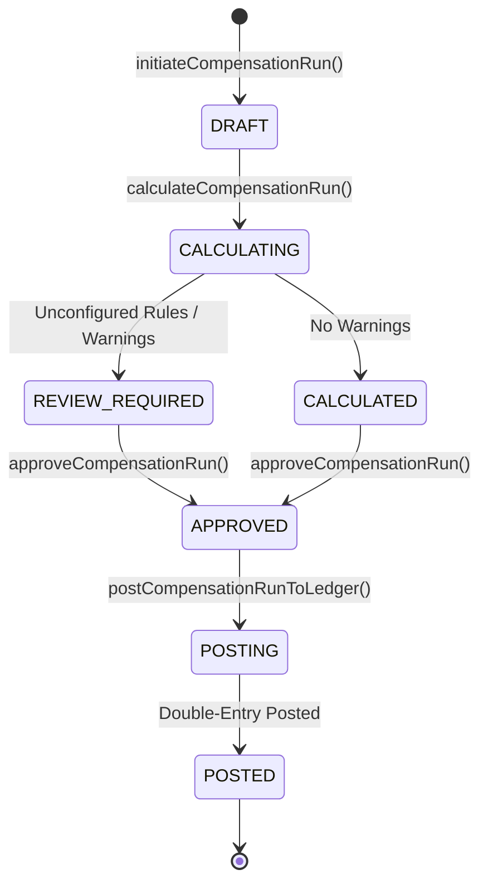

# Compensation Run Workflows & State Machine

## Compensation Run State Machine

## Workflow Execution Steps

1. **Initiation (`initiateCompensationRun`)**:
   - Creates a `CompensationRun` in `DRAFT` status for target `periodId`, `planVersionId`, and `countryCode`.
   - Idempotent: re-initiation returns existing run.

2. **Calculation (`calculateCompensationRun`)**:
   - Transitions state to `CALCULATING`.
   - Reads `MemberQualification` records.
   - Evaluates active and unconfigured `CompensationRule` items.
   - Builds self-contained historical snapshot JSON.
   - Persists `MemberCompensationResult` and `EarningLineItem` records.
   - Transitions state to `CALCULATED` or `REVIEW_REQUIRED` (if warnings exist).

3. **Preview (`previewCompensationRun`)**:
   - Calculates itemized earnings in-memory.
   - Produces preview DTO without writing to database or ledger.

4. **Approval (`approveCompensationRun`)**:
   - Validates run status is `CALCULATED` or `REVIEW_REQUIRED`.
   - Requires `finance:compensation:approve` permission.
   - Sets run status to `APPROVED` and records `approvedAt` / `approvedById`.

5. **Ledger Posting (`postCompensationRunToLedger`)**:
   - Validates run status is `APPROVED`.
   - Requires `finance:compensation:post` permission.
   - For each result with `finalPayableAmount > 0`, creates double-entry `JournalTransaction`.
   - Sets result and run status to `POSTED`.

6. **Adjustments (`createCompensationAdjustment`)**:
   - Does NOT delete or modify historical `MemberCompensationResult` or `JournalTransaction`.
   - Posts offsetting journal transaction via Prompt 05.
   - Creates `CompensationAdjustment` record linked to original result.
   - Updates `MemberCompensationResult` status to `ADJUSTED`.
