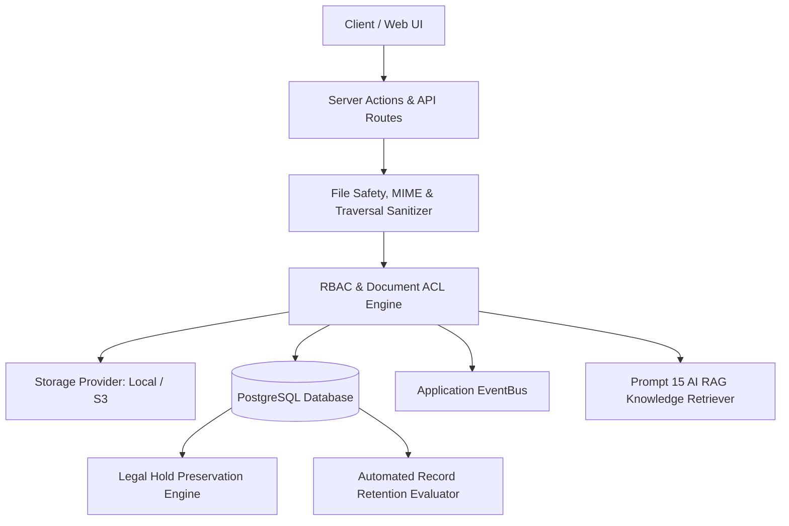

# Enterprise Document, Knowledge & Records Architecture (Module 21)

## 1. Executive Architectural Summary
Module 21 establishes the enterprise-grade Document, Knowledge & Records Management Engine for the Business Productivity & Leadership Operating System. It functions as the authoritative repository for digital assets, contracts, compliance documentation, Standard Operating Procedures (SOPs), knowledge collections, sequential immutable versioning, approval workflows, legal preservation holds, and record lifecycle retention.

## 2. Core Architectural Pillars

### 2.1 Uniform Storage Abstraction Layer
- Decouples storage operations from specific infrastructure backends.
- Backed by the `StorageProvider` interface with local filesystem (`LocalStorageProvider`) and AWS S3 object store (`S3StorageProvider`) implementations.
- Enforces content-addressable SHA-256 integrity verification and path traversal prevention on all read/write streams.

### 2.2 Strict Domain Authority & Ledger Isolation
- **Document Authority Only**: Module 21 is strictly responsible for document metadata, file storage references, knowledge collections, and legal preservation holds.
- **Ledger Isolation**: Zero direct mutations on `FinancialAccount`, `JournalTransaction`, or `JournalEntry` (Prompt 05/05.1 remains the sole financial ledger authority).
- **Generic Relational Linking**: Documents link to external business domains (CRM leads, projects, tasks, invoices) via immutable `DocumentRelation` entities without mutating domain records.

### 2.3 Sequential Immutable Versioning
- Document version numbers are strictly monotonic integers (`1, 2, 3...`).
- Historical versions cannot be mutated or deleted while the parent document is active.
- Restoring a previous version creates a new sequential version with audit lineage back to the source version.

### 2.4 Separation of Duties in Approval Workflows
- Multi-step approval state machine (`PENDING`, `APPROVED`, `REJECTED`, `CANCELLED`).
- Requesters cannot self-approve their own document releases.
- Approvals are version-specific: creating version `N+1` resets approval state to unapproved.

### 2.5 Legal Preservation Lock Precedence
- Documents subject to an active `RecordLegalHold` are protected from deletion across all API routes, Server Actions, and automated retention background jobs.
- Release of a legal hold requires explicit compliance authorization and produces tamper-evident audit logs.

