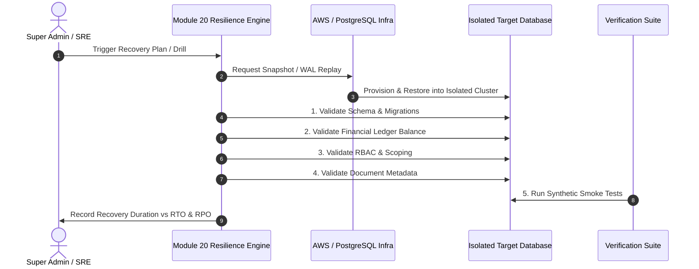

# Production Database Backup, Disaster Recovery & Restore Verification Architecture

## 1. Executive Summary
This document establishes the production Disaster Recovery (DR) and Backup Runbook for the **Business Productivity & Leadership Operating System**. It explicitly distinguishes the **Application Orchestration Layer (Module 20)** from the **Host Infrastructure Capabilities**.

---

## 2. Architecture Boundary: Application vs Infrastructure

```
┌────────────────────────────────────────────────────────────────────────────────────────┐
│ APPLICATION CAPABILITY (Module 20 — Code Base & Logic)                                 │
│  ├─ Backup Plan Schedules & Execution Tracking (`BackupPlan`, `BackupExecution`)       │
│  ├─ RPO & RTO Telemetry & SLA Violation Detection (`RecoveryObjective`)               │
│  ├─ Service Dependency Directed Acyclic Graph (DAG) with Cycle Prevention              │
│  ├─ Business Continuity Runbooks & Ordered Steps (`RecoveryPlan`, `RecoveryStep`)      │
│  ├─ Recovery Drills & Failure Simulation Engines (`RecoveryDrill`)                     │
│  ├─ Tamper-Evident Audit Trails & Telemetry for Governance (`src/modules/governance`)   │
│  └─ Production Readiness Health Endpoint (`/api/health/readiness`)                     │
└────────────────────────────────────────────────────────────────────────────────────────┘
                                            │ (Hooks & API Integration)
                                            ▼
┌────────────────────────────────────────────────────────────────────────────────────────┐
│ INFRASTRUCTURE CAPABILITY (Host Cloud & Database Provider)                             │
│  ├─ PostgreSQL Continuous WAL Archiving (Write-Ahead Logging via pgBackRest / WAL-G)   │
│  ├─ Automated Daily Physical Base Snapshots (AWS RDS Snapshot / EBS volume snapshot)   │
│  ├─ Cross-Region Asynchronous Replication (Primary: `eu-west-1` -> DR: `eu-central-1`) │
│  ├─ Encrypted S3 Immutable Object Vault (WORM Storage Policy / KMS encryption)         │
│  └─ Automated DNS Failover (Amazon Route 53 Health Checks / Latency Routing)           │
└────────────────────────────────────────────────────────────────────────────────────────┘
```

---

## 3. Production PostgreSQL Backup Strategy

### 3.1 Point-in-Time Recovery (PITR) Configuration
1. **WAL Archiving**: PostgreSQL continuous archiving configured with `archive_mode = on` and `archive_command = 'wal-g wal-push %p'`.
2. **Snapshot Cadence**:
   - Daily Full Physical Base Snapshot at 02:00 UTC.
   - Continuous WAL streaming with target **RPO <= 15 minutes**.
3. **Retention Policy**:
   - Hourly WALs retained for 14 days.
   - Daily physical snapshots retained for 35 days.
   - Monthly compliance snapshots retained for 7 years in immutable AWS Glacier vault.
4. **Encryption**: All backup artifacts encrypted at rest with AWS KMS Customer Managed Keys (`aws:kms`).

---

## 4. Disaster Recovery Restore Verification Procedure

When executing an automated or manual disaster recovery drill, follow this step-by-step procedure:



### 4.1 Step-by-Step Restoration Verification Steps
1. **Identify Target Backup**: Select verified snapshot ID and recovery target timestamp.
2. **Restore into Isolated Target Cluster**: Deploy snapshot into a sandbox staging database (`lawrence_app_recovery_test`).
3. **Validate Database Schema**:
   - Verify all 20 Prisma migrations exist in `_prisma_migrations` with `applied_steps_count` intact.
4. **Validate Critical Entities**:
   - Verify `User`, `Role`, `Permission`, `NetworkMember`, and `Organization` counts match pre-disaster metrics.
5. **Validate Double-Entry Financial Ledger Integrity**:
   - Run sum query across all `JournalEntry` rows to verify `sum(debitAmount) === sum(creditAmount)` across every posted transaction.
6. **Validate Server-Side RBAC**:
   - Verify `SUPER_ADMIN` role permissions (210 permissions) and role-permission mappings.
7. **Validate Multi-Tenancy Scoping**:
   - Verify member parent-child downline hierarchy integrity (`SponsorHistory`, `MemberMovementHistory`).
8. **Validate Document & Knowledge References**:
   - Verify `DocumentVersion` checksums match stored SHA-256 hashes.
9. **Record Metrics**:
   - Log execution duration against target **RTO <= 60 minutes**.
   - Log recovery point data delta against target **RPO <= 15 minutes**.
   - Emit `RecoveryCompleted` event and log record in `ResilienceIncident`.

---

## 5. RPO / RTO Target Summary

| Tier | Service Domain | Target RPO | Target RTO | Verification Frequency |
| :--- | :--- | :--- | :--- | :--- |
| **Tier 1** | Double-Entry Financial Ledger (05/05.1) | **<= 5 mins** | **<= 30 mins** | Daily Automated Check |
| **Tier 1** | Members, Organizations & Security (01, 02, 18) | **<= 15 mins** | **<= 30 mins** | Daily Automated Check |
| **Tier 2** | Documents, Knowledge & Records (21) | **<= 1 hour** | **<= 2 hours** | Weekly Verification |
| **Tier 2** | CRM, Projects, Billing & Retention (06, 10, 11, 12)| **<= 1 hour** | **<= 2 hours** | Weekly Verification |
| **Tier 3** | Analytics Cache, Command Center (09, 17) | **<= 24 hours** | **<= 4 hours** | Monthly Drill |
